# ICLR 2026 Main Papers — Part 115 of 199

27 papers.

- [PuzzleWorld: A Benchmark for Multimodal, Open-Ended Reasoning in Puzzlehunts](#paper-3082)
- [Self-Speculative Decoding Accelerates Lossless Inference in Any-Order and Any-Subset Autoregressive Models](#paper-3083)
- [Leveraging Explanation to Improve Generalization of Meta Reinforcement Learning](#paper-3084)
- [Virne: A Comprehensive Benchmark for RL-based Network Resource Allocation in NFV](#paper-3085)
- [HYPER: A Foundation Model for Inductive Link Prediction with Knowledge Hypergraphs](#paper-3086)
- [EditReward: A Human-Aligned Reward Model for Instruction-Guided Image Editing](#paper-3087)
- [Safe Continuous-time Multi-Agent Reinforcement Learning via Epigraph Form](#paper-3088)
- [CogniLoad: A Synthetic Natural Language Reasoning Benchmark With Tunable Length, Intrinsic Difficulty, and Distractor Density](#paper-3089)
- [Adaptive Hopfield Network: Rethinking Similarities in Associative Memory](#paper-3090)
- [Skywork-Reward-V2: Scaling Preference Data Curation via Human-AI Synergy](#paper-3091)
- [SocialJax: An Evaluation Suite for Multi-agent Reinforcement Learning in Sequential Social Dilemmas](#paper-3092)
- [Divid: Disentangled Spatial-Temporal Modeling within LLMs for Temporally Grounded Video Understanding](#paper-3093)
- [TetraGT: Tetrahedral Geometry-Driven Explicit Token Interactions with Graph Transformer for Molecular Representation Learning](#paper-3094)
- [Emergent Misalignment is Easy, Narrow Misalignment is Hard](#paper-3095)
- [Action-aware Dynamic Pruning for Efficient Vision-Language-Action Manipulation](#paper-3096)
- [ChemEval: A Multi-level and Fine-grained Chemical Capability Evaluation for Large Language Models](#paper-3097)
- [Expert Heads: Robust Evidence Identification for Large Language Models](#paper-3098)
- [CoEmoGen: Towards Semantically-Coherent and Scalable Emotional Image Content Generation](#paper-3099)
- [FlowCast: Trajectory Forecasting for Scalable Zero-Cost Speculative Flow Matching](#paper-3100)
- [Vision Language Models are Biased](#paper-3101)
- [Transducing Language Models](#paper-3102)
- [Reducing Contextual Stochastic Bilevel Optimization via Structured Function Approximation](#paper-3103)
- [Inference-Time Scaling of Discrete Diffusion Models via Importance Weighting and Optimal Proposal Design](#paper-3104)
- [When Shift Happens - Confounding Is to Blame](#paper-3105)
- [CogMoE: Signal-Quality–Guided Multimodal MoE for Cognitive Load Prediction](#paper-3106)
- [RAVENEA: A Benchmark for Multimodal Retrieval-Augmented Visual Culture Understanding](#paper-3107)
- [Robust Adversarial Quantification via Conflict-Aware Evidential Deep Learning](#paper-3108)

---

## PuzzleWorld: A Benchmark for Multimodal, Open-Ended Reasoning in Puzzlehunts

**Type:** Poster | [OpenReview](https://openreview.net/forum?id=5sAsjb2jCb)

### Images

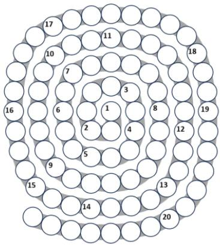

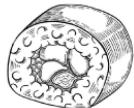

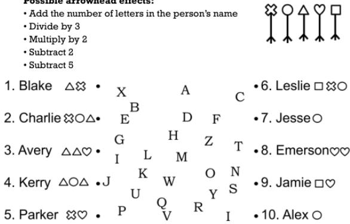

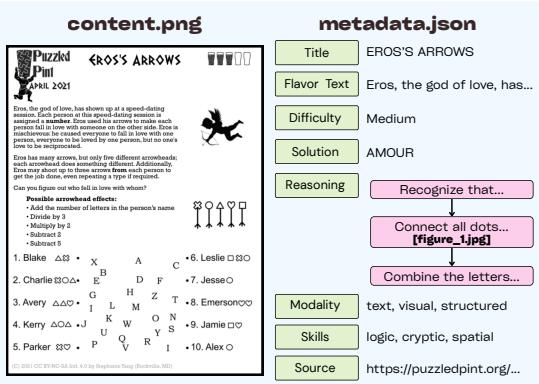

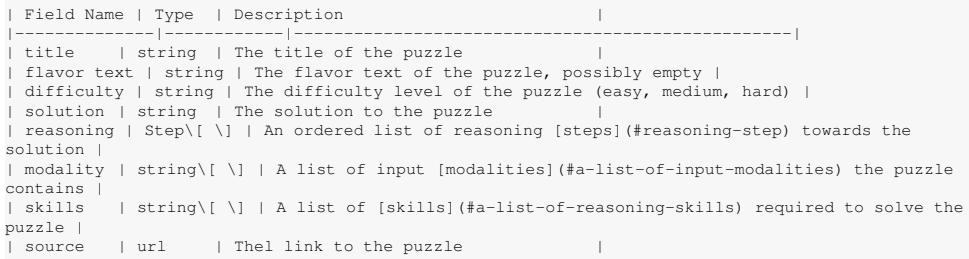

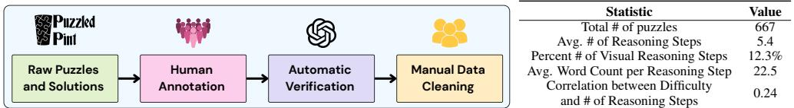

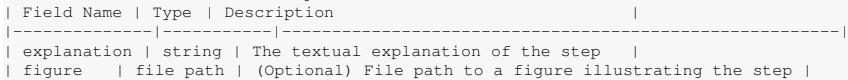

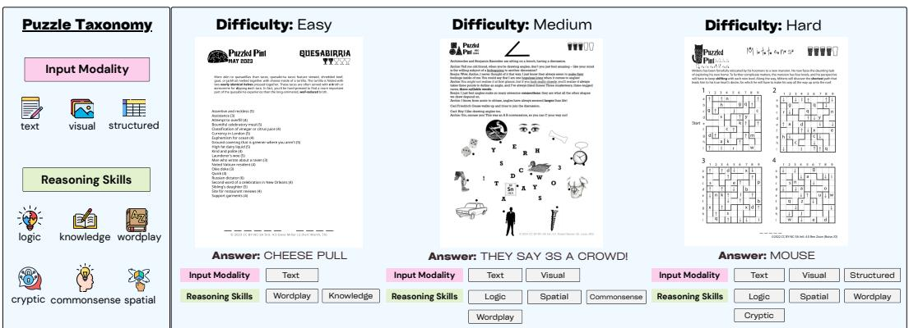

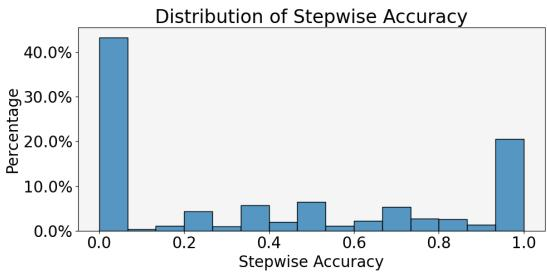

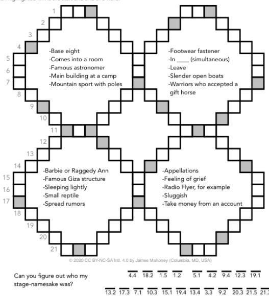

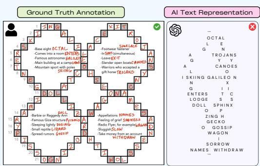

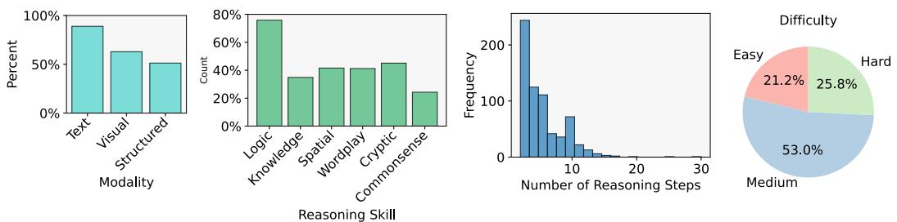

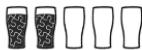

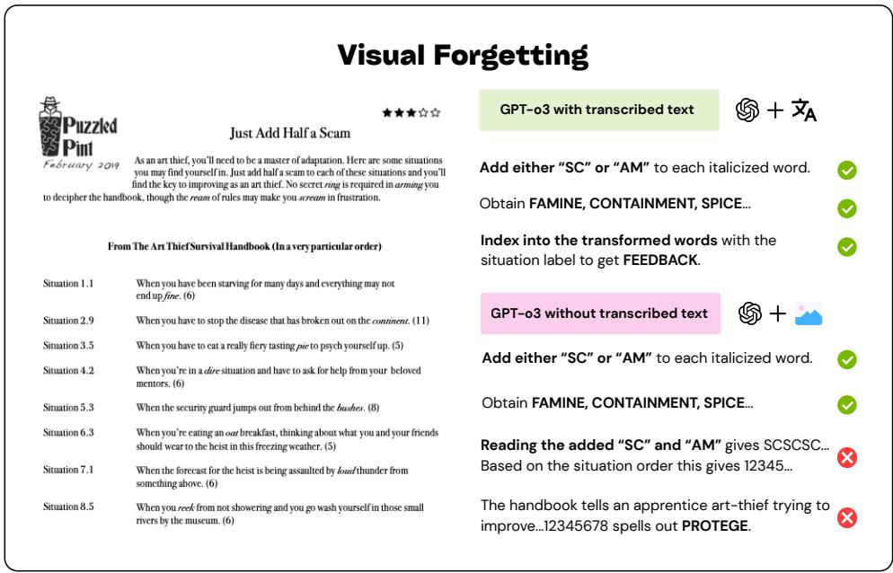

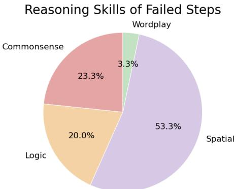

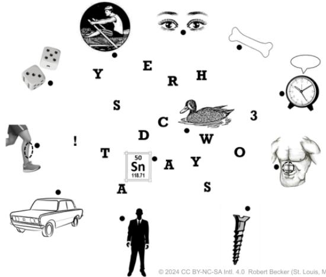

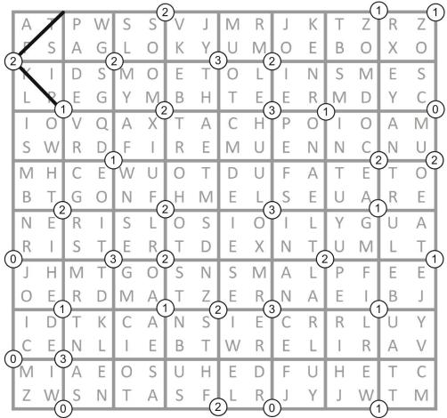

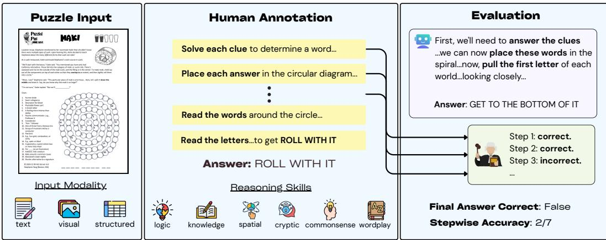

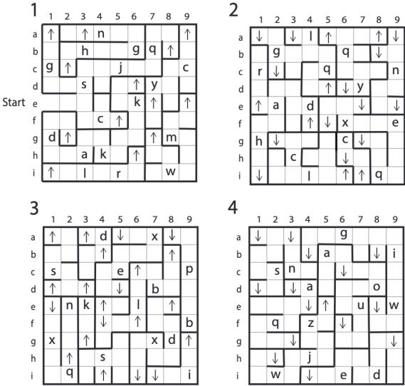

### Tables

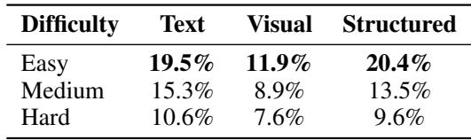

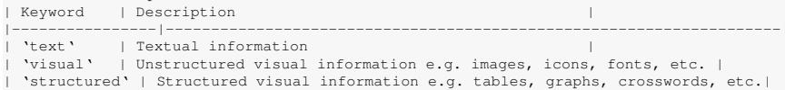

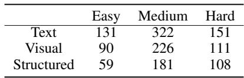

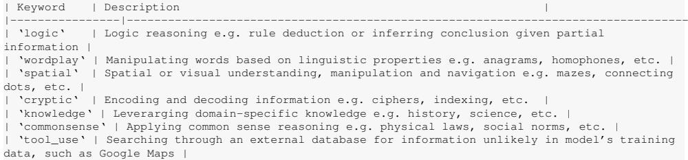

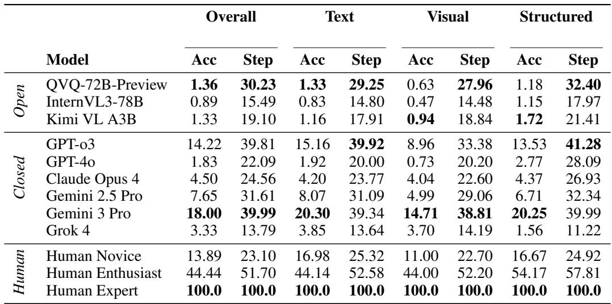

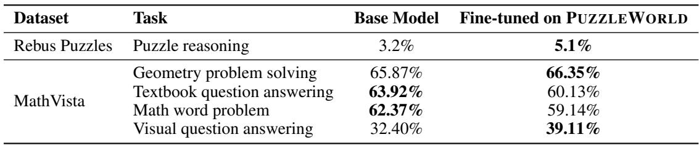

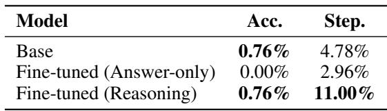

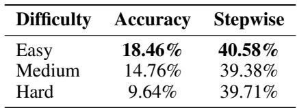

## Self-Speculative Decoding Accelerates Lossless Inference in Any-Order and Any-Subset Autoregressive Models

**Type:** Poster | [OpenReview](https://openreview.net/forum?id=hZnibTOke7)

### Images

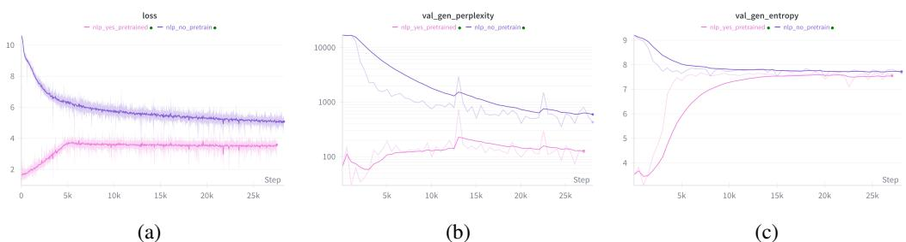

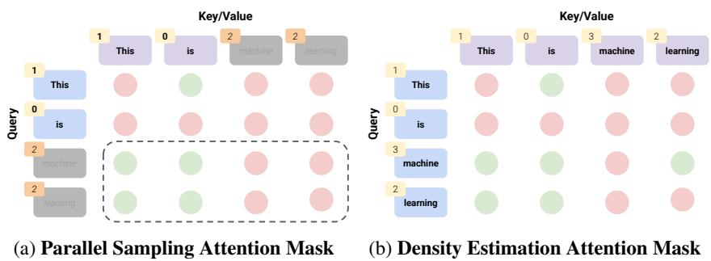

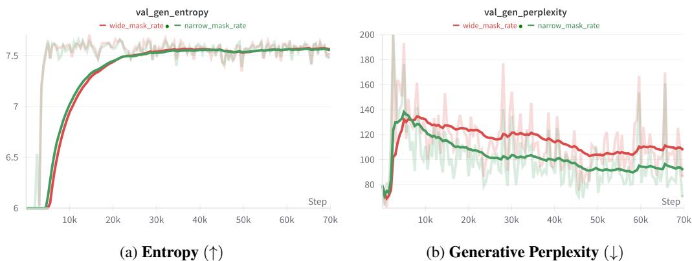

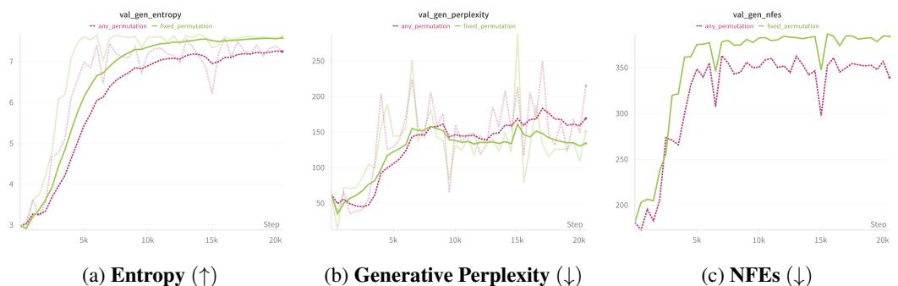

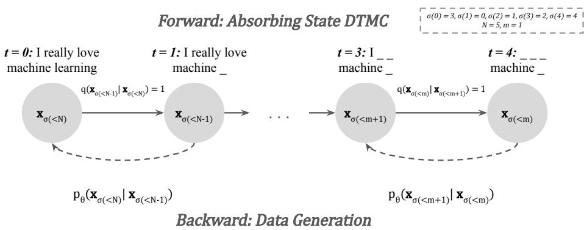

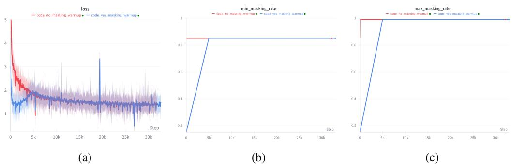

### Tables

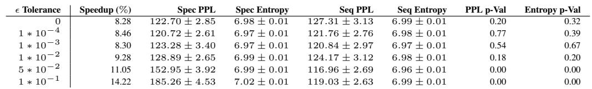

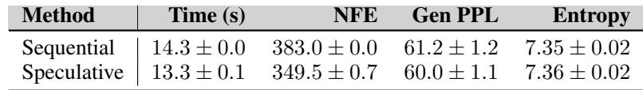

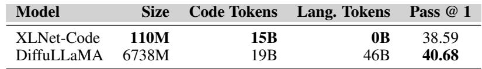

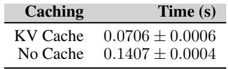

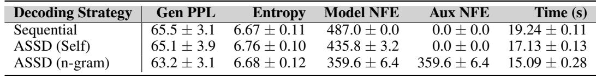

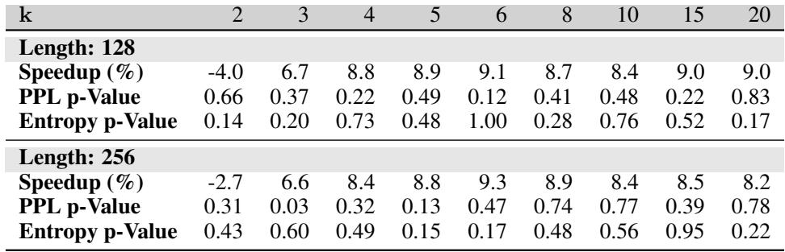

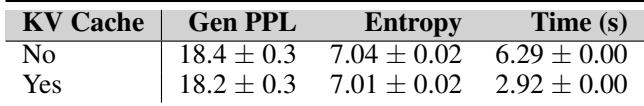

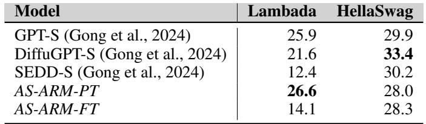

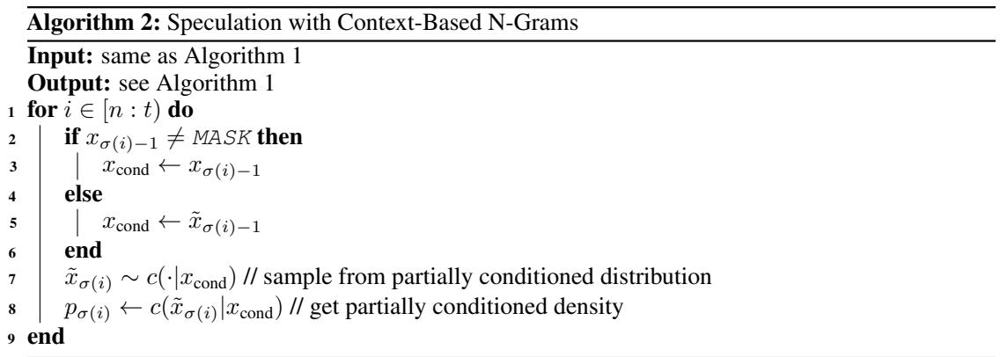

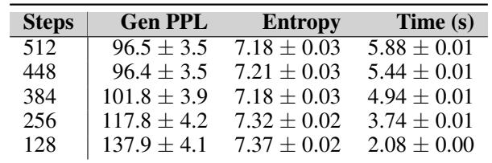

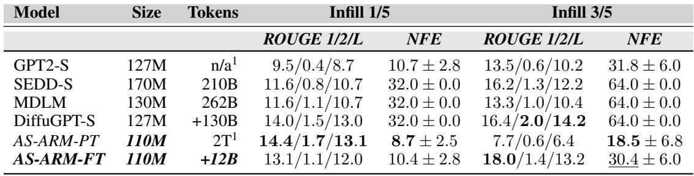

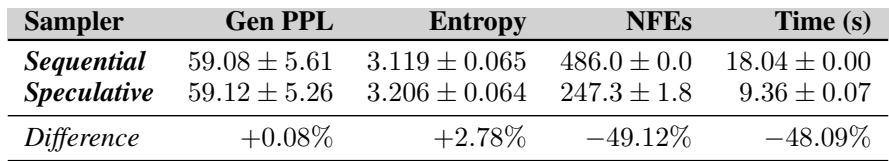

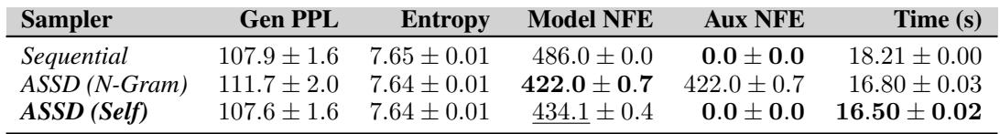

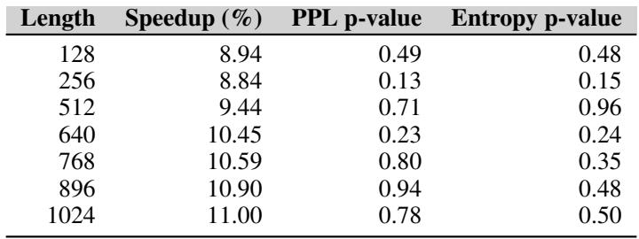

## Leveraging Explanation to Improve Generalization of Meta Reinforcement Learning

**Type:** Poster | [OpenReview](https://openreview.net/forum?id=Rg8PBd9Ow2)

### Images

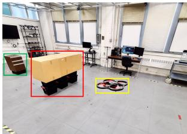

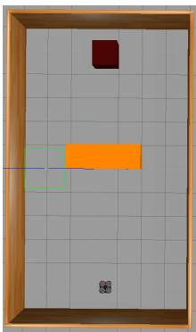

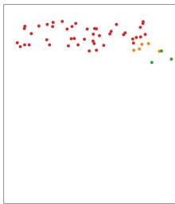

### Tables

## Virne: A Comprehensive Benchmark for RL-based Network Resource Allocation in NFV

**Type:** Poster | [OpenReview](https://openreview.net/forum?id=jngvm9MGyv)

### Images

### Tables

## HYPER: A Foundation Model for Inductive Link Prediction with Knowledge Hypergraphs

**Type:** Poster | [OpenReview](https://openreview.net/forum?id=YLTQbMoAaX)

### Images

### Tables

## EditReward: A Human-Aligned Reward Model for Instruction-Guided Image Editing

**Type:** Poster | [OpenReview](https://openreview.net/forum?id=eZu358JOOR)

### Images

### Tables

## Safe Continuous-time Multi-Agent Reinforcement Learning via Epigraph Form

**Type:** Poster | [OpenReview](https://openreview.net/forum?id=U6z5Y1htbe)

### Images

### Tables

## CogniLoad: A Synthetic Natural Language Reasoning Benchmark With Tunable Length, Intrinsic Difficulty, and Distractor Density

**Type:** Poster | [OpenReview](https://openreview.net/forum?id=0Sex2H5Jnn)

### Images

### Tables

## Adaptive Hopfield Network: Rethinking Similarities in Associative Memory

**Type:** Poster | [OpenReview](https://openreview.net/forum?id=HKSp4U69dy)

### Images

### Tables

## Skywork-Reward-V2: Scaling Preference Data Curation via Human-AI Synergy

**Type:** Poster | [OpenReview](https://openreview.net/forum?id=ofgxkMLqic)

### Images

### Tables

## SocialJax: An Evaluation Suite for Multi-agent Reinforcement Learning in Sequential Social Dilemmas

**Type:** Poster | [OpenReview](https://openreview.net/forum?id=Qg6kHVN91t)

### Images

### Tables

## Divid: Disentangled Spatial-Temporal Modeling within LLMs for Temporally Grounded Video Understanding

**Type:** Poster | [OpenReview](https://openreview.net/forum?id=mrViXFfrsU)

### Images

### Tables

## TetraGT: Tetrahedral Geometry-Driven Explicit Token Interactions with Graph Transformer for Molecular Representation Learning

**Type:** Poster | [OpenReview](https://openreview.net/forum?id=3WVihbSW0i)

### Images

### Tables

## Emergent Misalignment is Easy, Narrow Misalignment is Hard

**Type:** Poster | [OpenReview](https://openreview.net/forum?id=q5AawZ5UuQ)

### Images

### Tables

## Action-aware Dynamic Pruning for Efficient Vision-Language-Action Manipulation

**Type:** Poster | [OpenReview](https://openreview.net/forum?id=ea6j8k8Rnw)

### Images

### Tables

## ChemEval: A Multi-level and Fine-grained Chemical Capability Evaluation for Large Language Models

**Type:** Poster | [OpenReview](https://openreview.net/forum?id=JrqjSkEPrX)

### Images

### Tables

## Expert Heads: Robust Evidence Identification for Large Language Models

**Type:** Poster | [OpenReview](https://openreview.net/forum?id=rdKL5Uxyim)

### Images

### Tables

## CoEmoGen: Towards Semantically-Coherent and Scalable Emotional Image Content Generation

**Type:** Poster | [OpenReview](https://openreview.net/forum?id=PTzByqd0aJ)

### Images

### Tables

## FlowCast: Trajectory Forecasting for Scalable Zero-Cost Speculative Flow Matching

**Type:** Poster | [OpenReview](https://openreview.net/forum?id=gv8R88PVEG)

### Images

### Tables

## Vision Language Models are Biased

**Type:** Poster | [OpenReview](https://openreview.net/forum?id=DG4S2OlGQA)

### Images

### Tables

## Transducing Language Models

**Type:** Poster | [OpenReview](https://openreview.net/forum?id=qOyF214xmg)

### Images

### Tables

## Reducing Contextual Stochastic Bilevel Optimization via Structured Function Approximation

**Type:** Poster | [OpenReview](https://openreview.net/forum?id=3qzgB7QIDl)

### Images

### Tables

## Inference-Time Scaling of Discrete Diffusion Models via Importance Weighting and Optimal Proposal Design

**Type:** Poster | [OpenReview](https://openreview.net/forum?id=7wbrFQvfdH)

### Images

### Tables

## When Shift Happens - Confounding Is to Blame

**Type:** Poster | [OpenReview](https://openreview.net/forum?id=sFjxg8cyJS)

### Images

### Tables

## CogMoE: Signal-Quality–Guided Multimodal MoE for Cognitive Load Prediction

**Type:** Poster | [OpenReview](https://openreview.net/forum?id=UtbSWdWv0F)

### Images

### Tables

## RAVENEA: A Benchmark for Multimodal Retrieval-Augmented Visual Culture Understanding

**Type:** Poster | [OpenReview](https://openreview.net/forum?id=4zAbkxQ23i)

### Images

### Tables

## Robust Adversarial Quantification via Conflict-Aware Evidential Deep Learning

**Type:** Poster | [OpenReview](https://openreview.net/forum?id=27oJibuygA)

### Images

### Tables

