# ICLR 2026 Main Papers — Part 121 of 199

27 papers.

- [Convergence Analysis of Tsetlin Machines under Noise-Free and Noisy Training Conditions: From $2$ Bits to $k$ Bits](#paper-3244)
- [Type-Compliant Adaptation Cascades](#paper-3245)
- [SPIRAL: Self-Play on Zero-Sum Games Incentivizes Reasoning via Multi-Agent Multi-Turn Reinforcement Learning](#paper-3246)
- [Neuro-Symbolic Decoding of Neural Activity](#paper-3247)
- [Tracing the Traces: Latent Temporal Signals for Efficient and Accurate Reasoning](#paper-3248)
- [Critique-Coder: Enhancing Coder Models by Critique Reinforcement Learning](#paper-3249)
- [Sequential Parallel Duality in Prefix Scannable Models](#paper-3250)
- [SoFlow: Solution Flow Models for One-Step Generative Modeling](#paper-3251)
- [Setting up for failure: automatic discovery of the neural mechanisms of cognitive errors](#paper-3252)
- [SafeDialBench: A Fine-Grained Safety Evaluation Benchmark for Large Language Models in Multi-Turn Dialogues with Diverse Jailbreak Attacks](#paper-3253)
- [Don't Throw Away Your Pretrained Model](#paper-3254)
- [Generalizing Linear Autoencoder Recommenders with Decoupled Expected Quadratic Loss](#paper-3255)
- [Automating the Refinement of Reinforcement Learning Specifications](#paper-3256)
- [Single Index Bandits: Generalized Linear Contextual Bandits with Unknown Reward Functions](#paper-3257)
- [When Style Breaks Safety: Defending LLMs Against Superficial Style Alignment](#paper-3258)
- [ViPRA: Video Prediction for Robot Actions](#paper-3259)
- [A Structured, Tagged, and Localized Visual Question Answering Dataset with Full Sentence Answers and Scene Graphs for Chest X-ray Images](#paper-3260)
- [Seeing but Not Believing: Probing the Disconnect Between Visual Attention and Answer Correctness in VLMs](#paper-3261)
- [Sample Complexity and Representation Ability of Test-time Scaling Paradigms](#paper-3262)
- [Bilevel Optimization with Lower-Level Uniform Convexity: Theory and Algorithm](#paper-3263)
- [lmgame-Bench: How Good are LLMs at Playing Games?](#paper-3264)
- [QuoKA: Query-Oriented KV Selection for Efficient LLM Prefill](#paper-3265)
- [A universal compression theory for lottery ticket hypothesis and neural scaling laws](#paper-3266)
- [The Value of Information in Human-AI Decision-making](#paper-3267)
- [Terminal-Bench: Benchmarking Agents on Hard, Realistic Tasks in Command Line Interfaces](#paper-3268)
- [Homeostatic Adaptation of Optimal Population Codes under Metabolic Stress](#paper-3269)
- [Latent Wasserstein Adversarial Imitation Learning](#paper-3270)

---

## Convergence Analysis of Tsetlin Machines under Noise-Free and Noisy Training Conditions: From $2$ Bits to $k$ Bits

**Type:** Poster | [OpenReview](https://openreview.net/forum?id=feOrSQdD9Y)

### Images

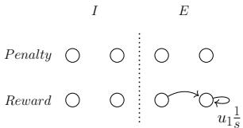

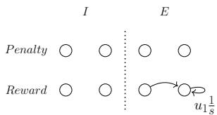

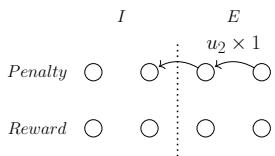

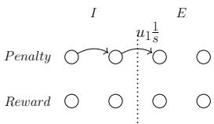

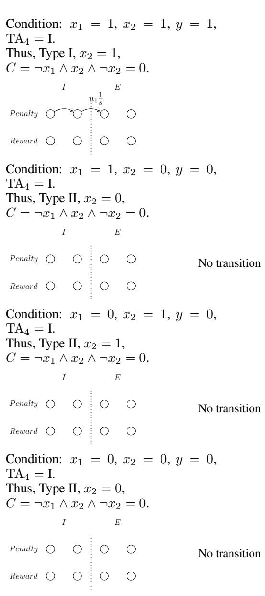

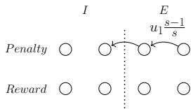

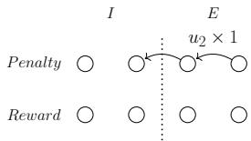

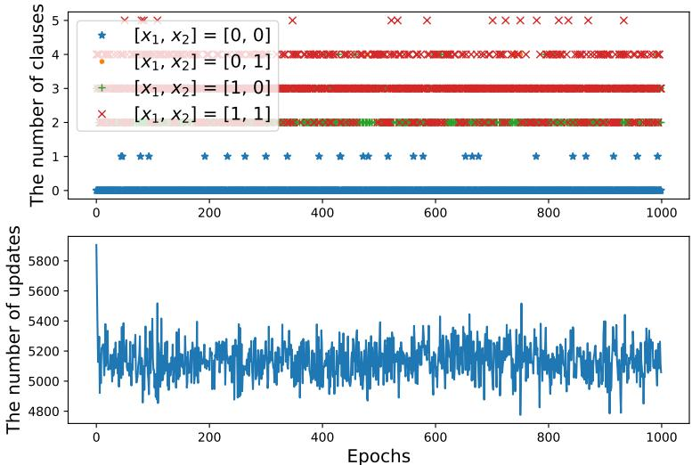

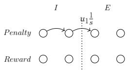

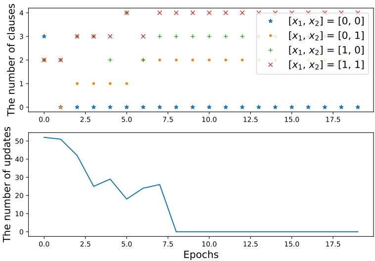

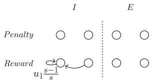

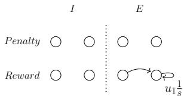

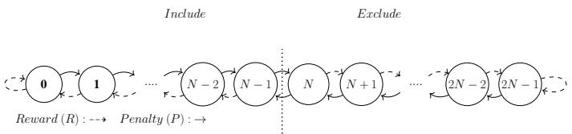

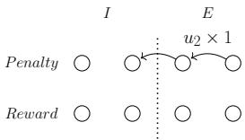

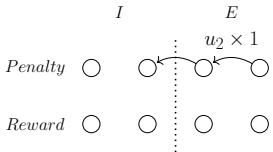

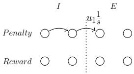

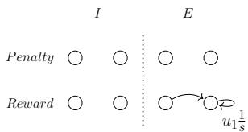

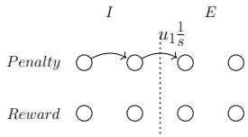

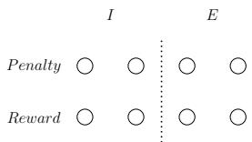

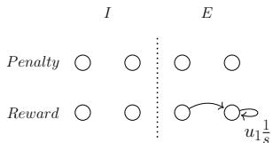

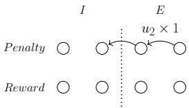

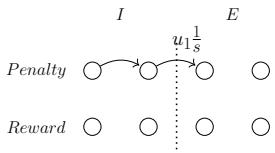

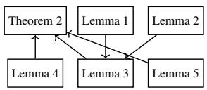

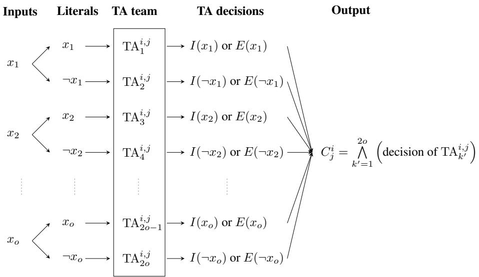

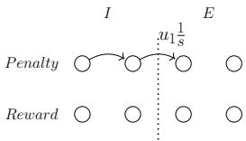

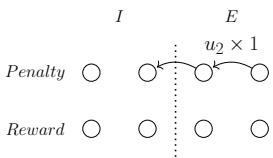

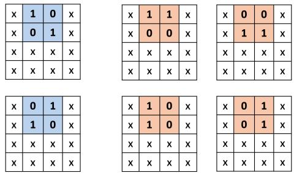

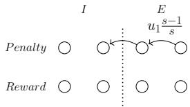

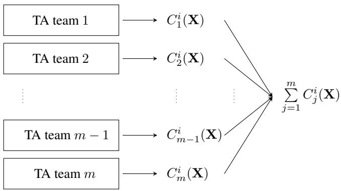

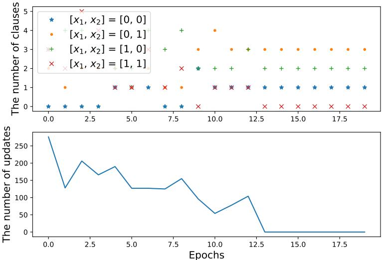

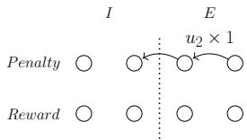

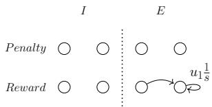

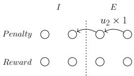

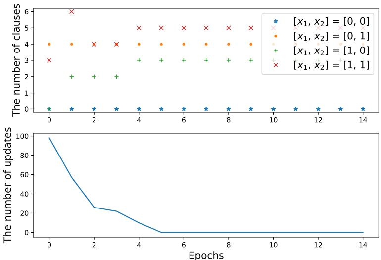

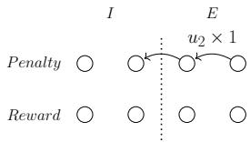

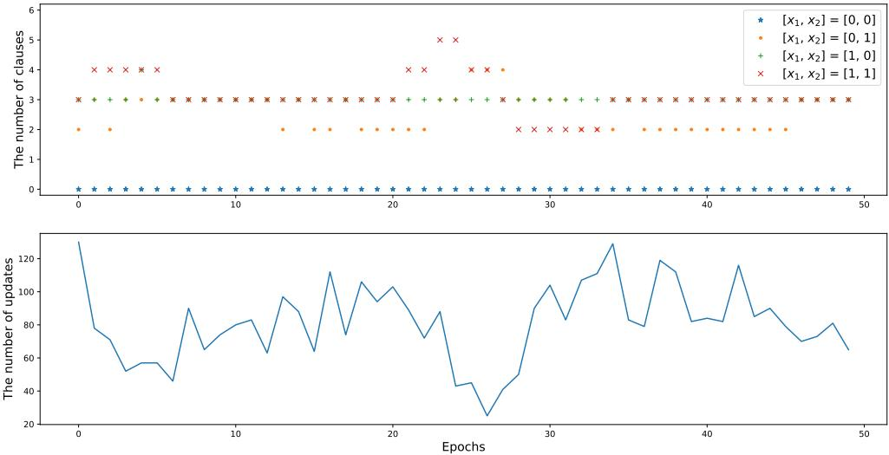

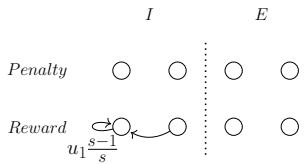

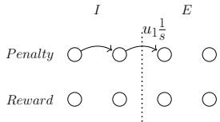

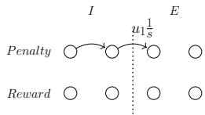

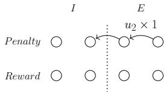

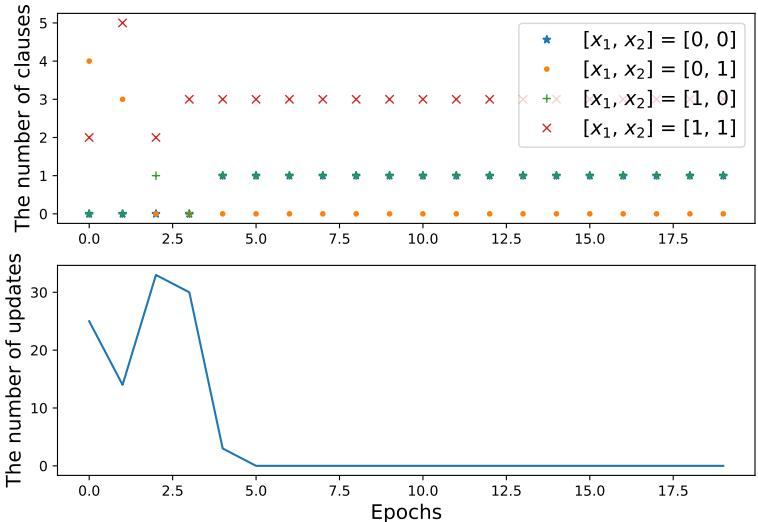

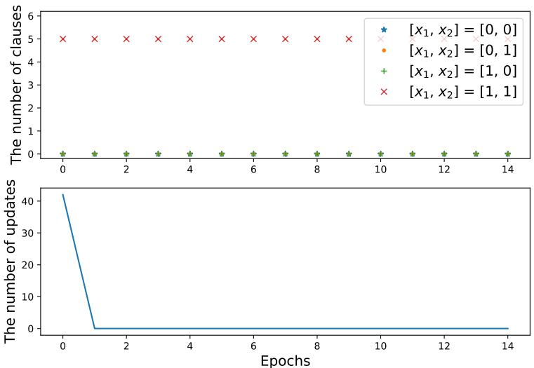

### Tables

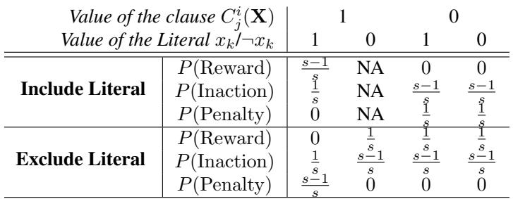

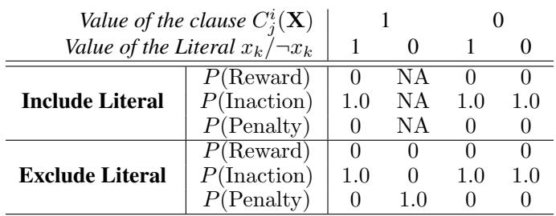

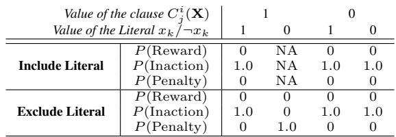

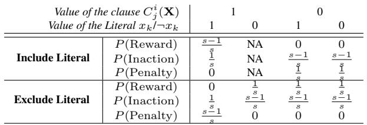

## Type-Compliant Adaptation Cascades

**Type:** Poster | [OpenReview](https://openreview.net/forum?id=aJmXct3igl)

### Images

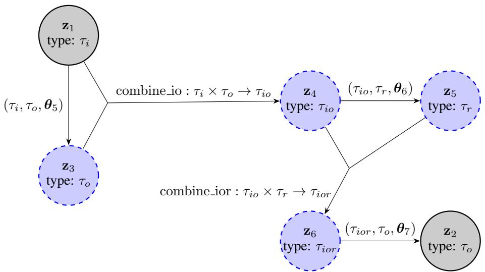

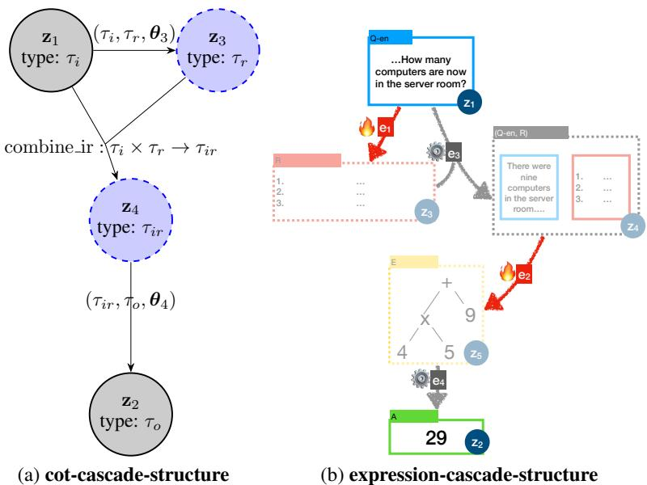

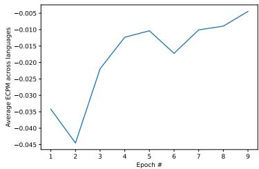

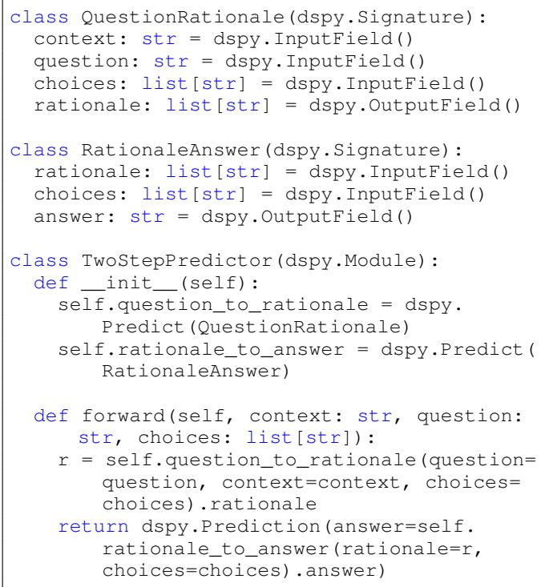

### Tables

## SPIRAL: Self-Play on Zero-Sum Games Incentivizes Reasoning via Multi-Agent Multi-Turn Reinforcement Learning

**Type:** Poster | [OpenReview](https://openreview.net/forum?id=7Yayy5fNLg)

### Images

### Tables

## Neuro-Symbolic Decoding of Neural Activity

**Type:** Poster | [OpenReview](https://openreview.net/forum?id=alEx0sm74l)

### Images

### Tables

## Tracing the Traces: Latent Temporal Signals for Efficient and Accurate Reasoning

**Type:** Poster | [OpenReview](https://openreview.net/forum?id=Ytlj8Ckv9n)

### Images

### Tables

## Critique-Coder: Enhancing Coder Models by Critique Reinforcement Learning

**Type:** Poster | [OpenReview](https://openreview.net/forum?id=tsuxIeLUsz)

### Images

### Tables

## Sequential Parallel Duality in Prefix Scannable Models

**Type:** Poster | [OpenReview](https://openreview.net/forum?id=tuLF84azND)

### Images

### Tables

## SoFlow: Solution Flow Models for One-Step Generative Modeling

**Type:** Poster | [OpenReview](https://openreview.net/forum?id=cjb03GNqYw)

### Images

### Tables

## Setting up for failure: automatic discovery of the neural mechanisms of cognitive errors

**Type:** Poster | [OpenReview](https://openreview.net/forum?id=NGThArVrD3)

### Images

### Tables

## SafeDialBench: A Fine-Grained Safety Evaluation Benchmark for Large Language Models in Multi-Turn Dialogues with Diverse Jailbreak Attacks

**Type:** Poster | [OpenReview](https://openreview.net/forum?id=KFjtRqVnKH)

### Images

### Tables

## Don't Throw Away Your Pretrained Model

**Type:** Poster | [OpenReview](https://openreview.net/forum?id=1TTeOEufHz)

### Images

### Tables

## Generalizing Linear Autoencoder Recommenders with Decoupled Expected Quadratic Loss

**Type:** Poster | [OpenReview](https://openreview.net/forum?id=ANH044Wdje)

### Images

### Tables

## Automating the Refinement of Reinforcement Learning Specifications

**Type:** Poster | [OpenReview](https://openreview.net/forum?id=a5jzk1hv2Y)

### Images

### Tables

## Single Index Bandits: Generalized Linear Contextual Bandits with Unknown Reward Functions

**Type:** Poster | [OpenReview](https://openreview.net/forum?id=aYDpQUcJTn)

### Images

### Tables

## When Style Breaks Safety: Defending LLMs Against Superficial Style Alignment

**Type:** Poster | [OpenReview](https://openreview.net/forum?id=a8QTAl5Hnb)

### Images

### Tables

## ViPRA: Video Prediction for Robot Actions

**Type:** Poster | [OpenReview](https://openreview.net/forum?id=w3Ik8HUyTT)

### Images

### Tables

## A Structured, Tagged, and Localized Visual Question Answering Dataset with Full Sentence Answers and Scene Graphs for Chest X-ray Images

**Type:** Poster | [OpenReview](https://openreview.net/forum?id=LrmyW9JLYq)

### Images

### Tables

## Seeing but Not Believing: Probing the Disconnect Between Visual Attention and Answer Correctness in VLMs

**Type:** Poster | [OpenReview](https://openreview.net/forum?id=JAI7afWA9e)

### Images

### Tables

## Sample Complexity and Representation Ability of Test-time Scaling Paradigms

**Type:** Poster | [OpenReview](https://openreview.net/forum?id=RJDIX75TEE)

### Images

### Tables

## Bilevel Optimization with Lower-Level Uniform Convexity: Theory and Algorithm

**Type:** Poster | [OpenReview](https://openreview.net/forum?id=dJgb3ngAvT)

### Images

### Tables

## lmgame-Bench: How Good are LLMs at Playing Games?

**Type:** Poster | [OpenReview](https://openreview.net/forum?id=qeziG97WUZ)

### Images

### Tables

## QuoKA: Query-Oriented KV Selection for Efficient LLM Prefill

**Type:** Poster | [OpenReview](https://openreview.net/forum?id=YS4N1YxXSM)

### Images

### Tables

## A universal compression theory for lottery ticket hypothesis and neural scaling laws

**Type:** Poster | [OpenReview](https://openreview.net/forum?id=vxkzW4ljeX)

### Images

### Tables

## The Value of Information in Human-AI Decision-making

**Type:** Poster | [OpenReview](https://openreview.net/forum?id=rp2RDBRA0Y)

### Images

### Tables

## Terminal-Bench: Benchmarking Agents on Hard, Realistic Tasks in Command Line Interfaces

**Type:** Poster | [OpenReview](https://openreview.net/forum?id=a7Qa4CcHak)

### Images

### Tables

## Homeostatic Adaptation of Optimal Population Codes under Metabolic Stress

**Type:** Poster | [OpenReview](https://openreview.net/forum?id=LMvlwGkXpX)

### Images

### Tables

## Latent Wasserstein Adversarial Imitation Learning

**Type:** Poster | [OpenReview](https://openreview.net/forum?id=xfnR9ok8HJ)

### Images

### Tables

