# ICLR 2026 Main Papers — Part 199 of 199

1 papers.

- [Task Tokens: A Flexible Approach to Adapting Behavior Foundation Models](#paper-5351)

---

## Task Tokens: A Flexible Approach to Adapting Behavior Foundation Models

**Type:** Poster | [OpenReview](https://openreview.net/forum?id=6T3wJQhvc3)

### Images

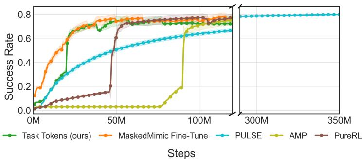

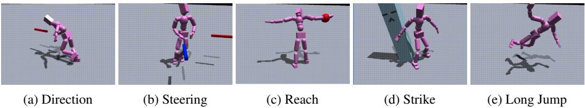

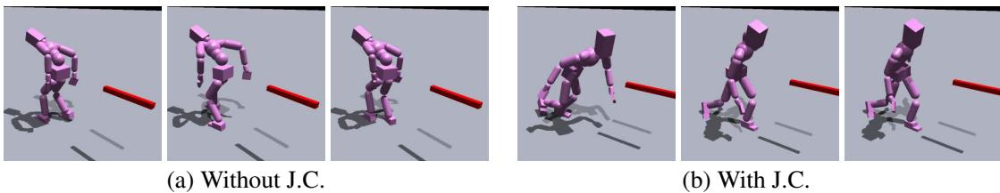

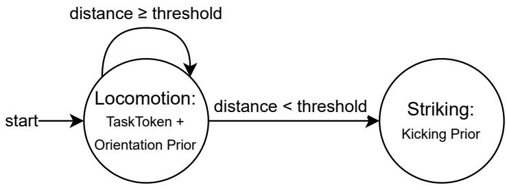

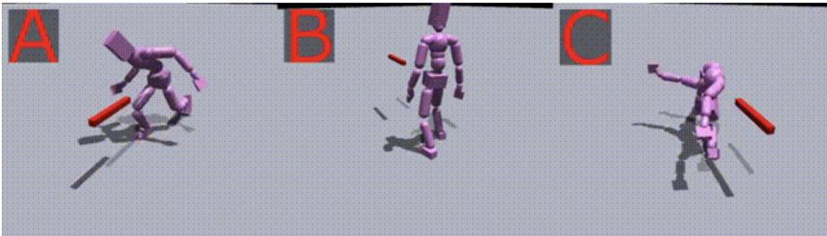

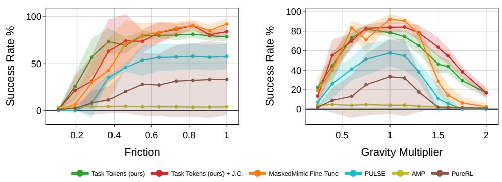

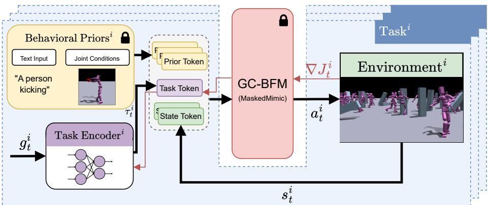

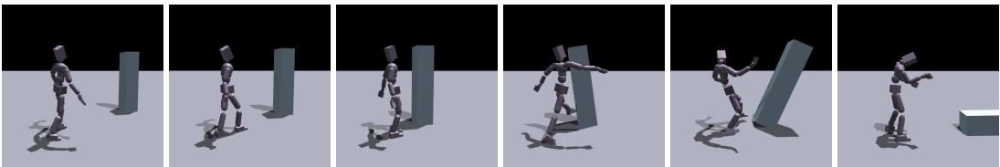

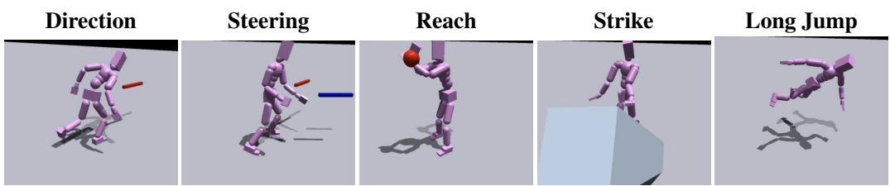

### Tables

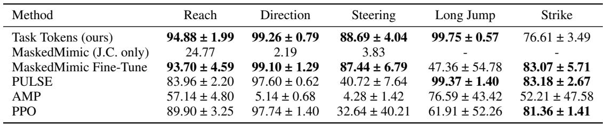

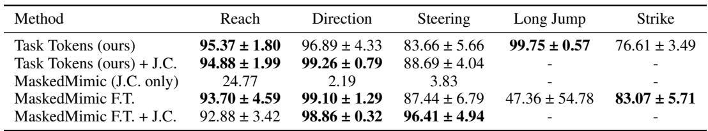

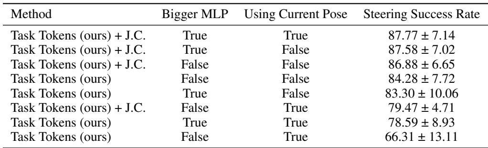

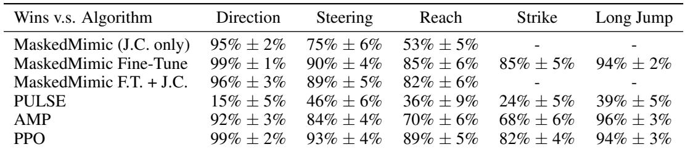
